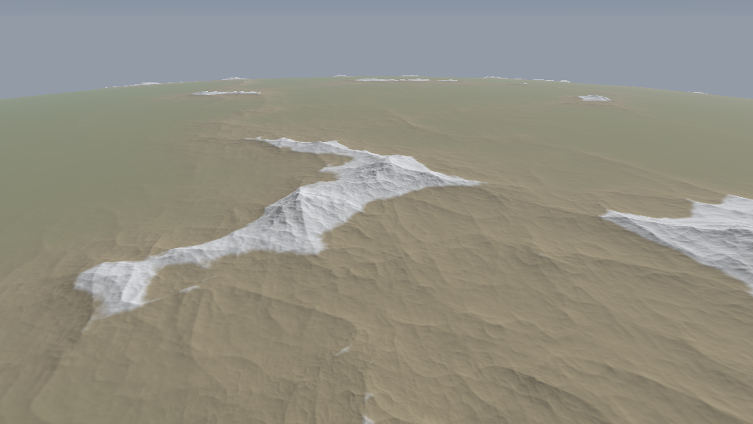
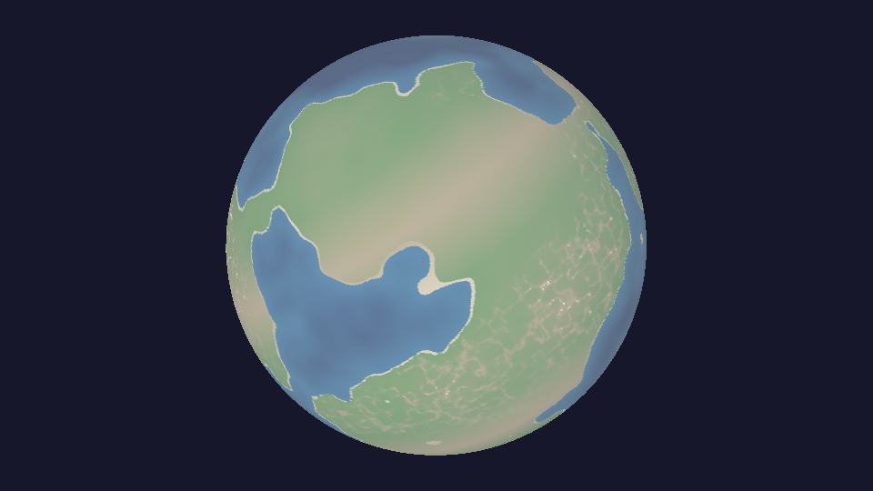
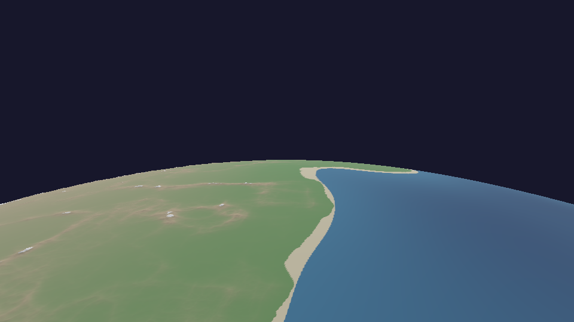

# terra

A planet-scale 3D globe engine in C++20, in the spirit of osgEarth or Cesium, written from scratch with no graphics libraries. It does WGS84 geodesy, a quadtree tile pyramid, level-of-detail selection with horizon and frustum culling, procedural planet terrain, and a software rasterizer that writes PNG. Every claim is checked against a geodesy reference, a closed form or brute force, and the one check it can't pass yet is listed openly.



|  |  |
|---|---|

**This is the starter**: the core engine is in place, and the roadmap below is the project.

```
$ ./build/terra --check
check                  result            value  threshold  measures
ecef-iogp-example      PASS        0.000511148      0.001  |ECEF - IOGP GN 7-2 worked example| (m)
ecef-roundtrip         PASS        1.67638e-08      1e-06  max position error over 200k points, h to 40 000 km (m)
vincenty-distance      PASS         0.00013866      0.001  |s - 54 972.271 m| Flinders Peak to Buninyong (m)
vincenty-azimuths      PASS         0.00312998       0.01  max azimuth error vs published (arcsec)
tile-pyramid           PASS                  0          0  points outside their tile + children not summing to parent
lod-coverage           PASS        5.07475e-14      1e-12  |leaf area - 4 pi| / 4 pi (+ overlapping leaves), 40 random cameras
lod-balanced           PASS                  1          1  max level difference between edge neighbours
horizon-cull-safe      PASS                  0          0  horizon-culled tiles with a visible point (33x33 brute force), of 3243
nadir-coverage         PASS                  0          0  1 - covered fraction, cameras at 300 m-150 km looking down
edge-seams             PASS        4.95919e-08      1e-06  same-level shared edge gap / tile size (float offsets)
skirt-covers-tjunction PASS           0.153017          1  T-junction gap / skirt depth, coarse-fine pairs
sphere-silhouette      PASS        7.89648e-05      0.005  covered pixels vs pi r^2 of the projected sphere (relative)
sphere-centre-depth    PASS        1.41965e-06     0.0001  depth at the image centre vs d - R (relative)
pole-slivers           KNOWN GAP       1303.81         20  worst edge ratio in a polar level-8 tile (non-degenerate)
determinism            PASS                  0          0  same scene rendered twice: hashes differ (0 = identical)

0 failed, 1 known gap
```

## Build and run

Needs a C++20 compiler (GCC 11+ or Clang 14+), CMake 3.24+, and Python 3 (standard library only). googletest ships in `third_party/`, so the build works offline.

```
cmake -S . -B build -DCMAKE_BUILD_TYPE=Release
cmake --build build -j
./build/terra render --stats --out view.png        # the mountain view above
./build/terra render --lat 10 --lon -40 --alt 400000 --pitch -20 --heading 80 --out orbit.png
./build/terra --check                              # the table above
./build/terra --bench                              # 1280x720 frame, timing breakdown
ctest --test-dir build                             # unit tests + the checks
python3 tools/mutants.py                           # plants bugs, reports what catches each
python3 tools/pngshrink.py view.png                # recompress (terra writes uncompressed PNG)
```

## How a frame is made

```
select   quadtree from the two level-0 tiles: cull by frustum and ellipsoid horizon (bounding
         spheres, conservative), refine while screen-space error > 2 px, then split leaves until
         edge neighbours differ by at most one level
mesh     per tile: 17x17 geodetic lattice, heights from 3D noise on the unit sphere, float offsets
         from a double tile centre, normals from an extra ring of samples, skirts on every edge
raster   per vertex Lambert + haze; clip at the near plane in camera space; edge-function
         rasterizer, top-left fill rule, 1/z float depth buffer (no far plane), gamma 2.2
```

## Known gaps

1. **Polar slivers**: plate carree tiles collapse at the poles (edge ratio 1300:1 at level 8). A cube-sphere or polar-cap profile would fix it.
2. **LOD shading seams**: a coarse tile computes normals from its coarse lattice, so the shading changes at level boundaries, which shows as faint arcs. Normal maps or geomorphing would fix it.
3. **No tile cache**: every visible tile is rebuilt every frame, single-threaded (about 0.75 s for the view above on an Apple M2).
4. **Terrain doesn't occlude** in culling, only the ellipsoid does. That's correct but wasteful in valleys.
5. **Procedural planet only**: no real elevation or imagery yet.

## Roadmap

| Stage | What | Checked by |
|---|---|---|
| 1 | Tile pager: LRU cache, worker threads, frame-to-frame reuse, simulated I/O latency | identical images with and without the cache; no frame waits on a missing tile |
| 2 | Real data: a packed DEM region (e.g. SRTM) with bilinear sampling and quadtree min/max bounds | heights vs source samples; tighter culling measured |
| 3 | Atmosphere: precomputed single-scattering sky and aerial perspective | sky colour vs the analytic Rayleigh limit; energy conservation |
| 4 | Cube-sphere tiles to remove the polar slivers, plus geomorphing | pole-slivers check passes; no popping between frames |
| 5 | Orbits: SGP4 propagation from TLEs, ground tracks and satellites drawn on the globe | published SGP4 verification vectors |
| 6 | Flythrough: camera paths rendered to frame sequences, plus a local web viewer for Chrome | Playwright screenshots match the CLI renders |

## What catches what

`tools/mutants.py` plants each bug in a scratch copy, then runs the unit tests and `--check`:

| Mutant | Bug | Unit tests | Checks |
|---|---|---|---|
| e2-sign | ECEF z uses 1 + e^2 | 1 fail | 2 fail |
| geodetic-one-iteration | inverse stops after one step | pass | 1 fail |
| vincenty-c-term | Vincenty's C doubled | pass | 2 fail |
| child-quadrant-mixup | child row from the column bit | 2 fail | 4 fail |
| no-balance | quadtree never balanced | pass | 1 fail |
| horizon-plane-ignored | horizon test checks only the cone | 2 fail | 4 fail |
| bounding-sphere-halved | bounding spheres too small | 1 fail | 1 fail |
| shallow-skirts | skirts shorter than the cracks | pass | 1 fail |
| fill-rule-inclusive | shared-edge pixels drawn twice | 1 fail | pass |
| no-near-clip | geometry behind the camera projected | 1 fail | pass |
| no-depth-test | far triangles overwrite near ones | 1 fail | pass |
| focal-from-width | focal length from the width | 1 fail | 1 fail |

All 12 are caught. The last three rasterizer bugs are caught only by unit tests.

## Layout

```
include/terra/  vec  ellipsoid  tiles  terrain  camera  select  mesh  render
src/            one .cpp per header
tools/          terra.cpp (CLI, --check, --bench)  mutants.py  pngshrink.py
tests/          geo_test  tiles_test  raster_test
docs/           the images above
```

References: IOGP Guidance Note 7-2 (geodetic to geocentric conversion); T. Vincenty, *Survey Review* 23(176), 1975; Cesium's ellipsoidal horizon occlusion (scaled space).
